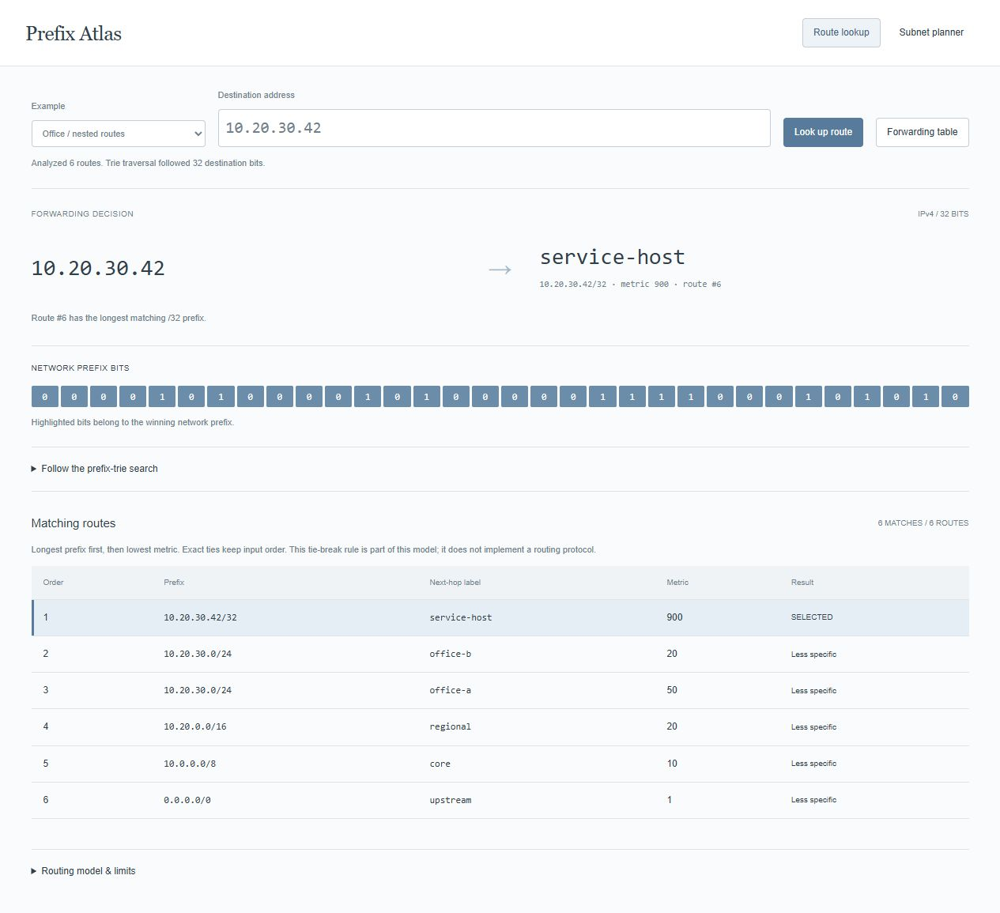

# Prefix Atlas

A local networking workbench for explaining forwarding decisions and planning subnet boundaries. It supports IPv4 and IPv6, uses separate binary prefix tries, and exports exact-count subnet plans without enumerating address spaces.



## Run

Python 3.11+; no runtime dependencies.

```sh
python run.py --port 8000
```

Open http://127.0.0.1:8000. The browser sends bounded analysis requests to the local Python server. The app does not resolve DNS, probe destinations, change routing tables, or save submitted routes to disk. Export a table or report before refreshing if you want to retain it.

## Route lookup

The lookup page puts the destination and winning route above the prefix bits and ordered matches. Open **Forwarding table** to edit routes, then choose **Apply and look up**. The **Subnet planner** tab keeps address-range planning separate.

Enter one forwarding entry per line:

```text
# CIDR next-hop-label metric
0.0.0.0/0 upstream 1
10.0.0.0/8 core 10
10.20.30.0/24 office-a 50
10.20.30.0/24 office-b 20
10.20.30.42/32 service-host 900
```

For `10.20.30.42`, the /32 host route wins despite its larger metric. For `10.20.30.43`, both /24 routes match and `office-b` wins on metric. The interface shows all matching candidates in preference order, the winning prefix bits, and the trie depths at which matching routes were encountered.

Selection is **longest prefix, then lowest metric, then earliest input order**. Only the first rule is the general forwarding principle being illustrated; the remaining rules define this simplified workbench. It does not implement administrative distance, BGP path selection, policy routing, ECMP, recursive next-hop resolution, or interface reachability. Next-hop values are labels, not addresses the app contacts.

IPv4 and IPv6 entries can coexist but never match across address families. A missing match means this model has no route. Special-purpose addresses are treated as address bits; the app does not decide whether forwarding them would be valid on an actual network.

## Subnet planner

Choose a canonical parent network and an equal or longer prefix. For example, `192.0.2.0/24` split to /26 produces four 64-address networks.

The result includes exact address and subnet counts, first and last addresses, and at most 64 subnet CIDRs. Even `::/0` split to /128 remains bounded: its count is `340282366920938463463374607431768211456`, but only the first 64 entries are constructed.

Large counts are JSON decimal strings and are formatted with JavaScript `BigInt`, avoiding floating-point rounding. Exports contain the same bounded preview and explicitly mark truncation. Counts describe all addresses, not usable hosts; no universal subtraction for network/broadcast addresses is applied. The last address is a range boundary, not an IPv6 broadcast address.

## Validation and limits

- Up to 128 routes and 32,000 characters of route text.
- Route files up to 128 KB, decoded as strict UTF-8.
- CIDRs require a decimal prefix and zero host bits. Errors suggest a canonical boundary when possible.
- Next-hop labels: 1–40 letters, digits, dots, underscores, colons, or hyphens.
- Metrics: integers 0–65535; exact ties retain input order.
- IPv4 addresses use strict dotted-decimal notation. Scoped IPv6 addresses are excluded.
- API bodies are limited to 128 KB; unknown fields, duplicate JSON keys, and non-finite values are rejected.

Editing input immediately clears the corresponding result and disables its report export. A sequence counter prevents an older response from replacing a newer edit. Lookup and subnet planning maintain independent reports.

## API

All computation is stateless. POST JSON to the local server:

| Endpoint | Request |
| --- | --- |
| `GET /api/examples` | Returns the three included forwarding examples. |
| `POST /api/lookup` | `{"routes":"0.0.0.0/0 upstream 1","destination":"192.0.2.1"}` |
| `POST /api/subnets` | `{"cidr":"192.0.2.0/24","new_prefix":26}` |

Success returns HTTP 200 JSON. Invalid inputs return 400 with an `error` string; blocked cross-site requests return 403; unknown routes return 404. The server binds to loopback, checks Host and Origin, serves only the three interface assets, and sends a restrictive content security policy. It is a local development server, not an authenticated public service.

## Implementation

`routing.py` validates networks with Python's `ipaddress`, builds separate binary tries, and traverses destination bits from most to least significant. Routes are collected at visited prefix nodes and ranked using the documented rules. Subnet previews are constructed arithmetically from the parent base address and subnet size.

For R routes and address width W (32 or 128), building the trie is O(RW); traversal is O(W), followed by sorting M matching candidates in O(M log M). The implementation favors transparent decisions over compressed-trie optimizations. A subnet plan constructs at most 64 network objects, regardless of the number of addresses in the parent.

`run.py` exposes the bounded local API. `app.js` handles the two tool views, pending-result invalidation, exact integer formatting, and exports. No package installation is needed.

## Verify

```sh
python -m unittest discover -s tests -v
node --check app.js
```

The 11 tests cover both address families, /0 defaults, /32 and /128 hosts, exact ties, invalid boundaries, missing routes, large integer serialization, API boundaries, and subnet limits. Generated forwarding tables are checked against an independent linear `ipaddress` membership scan for 800 destinations across both families. CI runs Python 3.11/3.13 on Linux and Windows, plus JavaScript syntax checking with Node 22.

Browser checks cover metric tie-breaking, IPv6's 128-bit display, missing routes, `2^128` counts, bounded previews, JSON export, boundary errors, and stale-export disabling. The subnet view was also checked at a 390-pixel viewport.

## References

- [RFC 4632: Classless Inter-domain Routing](https://www.rfc-editor.org/info/rfc4632/)
- [RFC 1812: Requirements for IP Version 4 Routers](https://www.rfc-editor.org/info/rfc1812/)
- [RFC 7608: IPv6 Prefix Length Recommendation for Forwarding](https://www.rfc-editor.org/info/rfc7608/)
